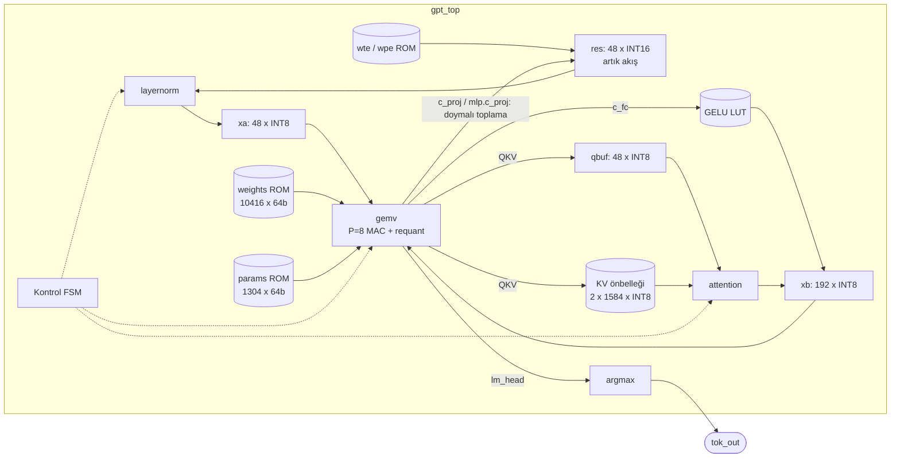

# 2. Donanım Mimarisi

Hedef: `start` darbesi başına **bir token** işleyen (KV önbellekli decode), tamamen tamsayı bir
minGPT çıkarım hızlandırıcısı. Ağırlıklar çip üzerindeki ROM'larda (BRAM), ara değerler küçük yerel
tamponlarda tutulur. Harici bellek kullanılmaz.

## 2.1 Blok diyagramı



## 2.2 Üst seviye arayüz (`rtl/gpt_top.sv`)

| Port | Yön | Açıklama |
|---|---|---|
| `clk`, `rst_n` | in | saat, senkron aktif-düşük reset |
| `start` | in | 1 çevrimlik darbe: `tok_in`'i `pos` konumunda işle |
| `tok_in [TOK_W]`, `pos [POS_W]` | in | giriş token'ı ve konumu ($0 \le pos < T$) |
| `busy`, `done` | out | meşgul / bitti (1 çevrimlik darbe) |
| `tok_out [TOK_W]` | out | $\arg\max$ logit (bir sonraki token) |
| `logits [V][16]` | out | INT16 logitler (ölçek $S_{logit}$) |
| `dbg_addr`, `dbg_res` | in/out | artık akışın asenkron okunması (test için) |

Bir dizi üretmek için `pos = 0, 1, 2, …` sırasıyla verilir. KV önbelleği konumlar arasında korunur.
Yeni bir diziye `pos = 0` ile başlanır; eski önbellek satırları sadece $j \le pos$ okunduğu için zararsızdır.

## 2.3 Kontrol akışı

FSM, `model.py`'deki `forward()` fonksiyonunu adım adım izler. Her durumun ilk çevriminde (`kick`) ilgili
alt birim başlatılır ve durum, birimin `done` sinyalini bekler:

```
S_IDLE ─start─► S_EMB ─► ┌─► S_LN1 ─► S_QKV ─► S_ATT ─► S_PROJ ─► S_LN2 ─► S_FC ─► S_MPROJ ─┐
                         └───────────────────────── layer < L-1 ─────────────────────────────┘
                                                        │ layer = L-1
                                                        ▼
                                          S_LNF ─► S_HEAD ─► S_DONE ─► S_IDLE
```

| Durum | Birim | Kaynak → Hedef | Not |
|---|---|---|---|
| `S_EMB` | ROM | wte, wpe → res | $x = W_{te}[\tau] + W_{pe}[t]$, doymalı INT16 |
| `S_LN1/LN2/LNF` | layernorm | res → xa | afin kısım katlanmış |
| `S_QKV` | gemv (48→144) | xa → qbuf / K / V | K,V satırı `(layer, pos)` adresine |
| `S_ATT` | attention | qbuf, K, V → xb[0..47] | 3 head ardışık |
| `S_PROJ` | gemv (48→48) | xb → res | **res += …** (INT16 requant) |
| `S_FC` | gemv (48→192) | xa → xb | çıkış GELU LUT'tan geçer |
| `S_MPROJ` | gemv (192→48) | xb → res | **res += …** |
| `S_HEAD` | gemv (48→8) | xa → logits | ilk $V$ çıkış, akış hâlinde argmax |

## 2.4 GEMV motoru (`rtl/gemv.sv`)

**Dataflow: output-stationary** [Sze17]. $P$ adet MAC şeridi, aynı anda $P$ farklı çıkış nöronunu
hesaplar. Her çevrimde:

* bir aktivasyon $x_i$ okunur ve bütün şeritlere **yayınlanır** (broadcast),
* ağırlık ROM'undan tek bir $8P$-bit kelime okunur: $\{W_{o+P-1,i}, …, W_{o,i}\}$,
* her şerit $acc_p \mathrel{+}= W_{o+p,i}\cdot x_i$ işlemini yapar (INT8×INT8 → INT32).

$n_{in}$ çevrim sonunda $P$ akümülatör hazırdır. Değerler bir **gölge (shadow) yazmaç bankasına**
kopyalanır ve `requant` birimine çevrim başına bir tane olacak şekilde aktarılır. Bu sırada şeritler bir
sonraki $P$ çıkışı hesaplamaya başlamıştır, yani boru hattında boşluk (bubble) oluşmaz:

```
çevrim     :  0     1     2    ...   47    48    49    50   ...  57   58   59
issue      : i=0   i=1   i=2   ...  i=47  i=0'  i=1'  i=2' ...
MAC        :       i=0   i=1   ...  i=46  i=47* i=0'  i=1' ...            (* handoff → gölge banka)
param ROM  :                                    p=0   p=1  ...  p=7
requant    :                                          s1    s2 ... → out_valid (idx o..o+7)
```

**Çevrim sayısı:** $\frac{n_{out}}{P}\, n_{in} + 14$ (son bloğun requant'ı, boru hattının dolup boşalması ve FSM; ölçülmüştür). Ağırlık ROM'u bu sırayla düzenlendiği için adres
basit bir sayaçtır (`w_ptr++`). **Koşul:** $n_{in} > P$ (gölge banka bir sonraki teslimden önce boşalmalıdır).

**Ağırlık ROM düzeni** (`sw/export.py`): her Linear için, her $P$'li çıkış bloğu için, her giriş $i$ için
bir kelime yazılır. Şerit $p$ = bit $[8p+7 : 8p]$. Katman düzeni düzenli olduğundan adres
`layer * W_PER_LAYER + W_OFF_<linear>` ile hesaplanır.

**Parametre ROM'u:** çıkış kanalı başına 64 bit: `{bias[63:32], m0[31:16], 8'b0, sh[7:0]}`.

## 2.5 LayerNorm birimi (`rtl/layernorm.sv`)

Bölüm 1.6'daki formüllerin doğrudan karşılığıdır. Birimin aşamaları:

1. `SUM`: $s = \sum x_i$ (48 çevrim)
2. `VAR`: $d_i = 48x_i - s$, $Q \mathrel{+}= d_i^2$ (48 çevrim, 1 boru hattı katmanı)
3. `SQRT`: $rt = \lfloor\sqrt{Q+E}\rfloor$, `isqrt_seq`, 32 çevrim
4. `DIV`: $inv = \lfloor K / rt \rfloor$, `div_seq`, 48 çevrim
5. `OUT`: $z_i = \mathrm{sat}_8((d_i\cdot inv + 2^{31}) \gg 32)$ (48 çevrim) → xa

Toplam 234 çevrim/LN olarak ölçülmüştür.

## 2.6 Dikkat birimi (`rtl/attention.sv`)

Her head için (Bölüm 1.7):

| Aşama | İşlem | Çevrim |
|---|---|---|
| `SCORE` | $s_j = q\cdot k_j$, koşan maksimum $m$ | $16(t+1)$ |
| `EXP` | $u_j = (m-s_j)C_{exp}$; $e_j = \mathrm{LUT}[f] \gg n$; $E \mathrel{+}= e_j$ | $(t+1)+2$ |
| `DIV` | $R = \lfloor 2^{32}/E \rfloor$ | 48 |
| `AV` | $A_d = \sum_j e_j v_{j,d}$; $y_d = (A_d R + 2^{31}) \gg 32$ | $16(t+1)$ |

`EXP` aşaması zamanlama için 2 kademeli bir boru hattıdır (çarpma | LUT ve kaydırma).

## 2.7 Bellek haritası

| Bellek | Boyut | Beklenen gerçekleme | İçerik / format |
|---|---|---|---|
| weights ROM | 10 416 × 64 bit (83.3 KB) | BRAM (~21 × RAMB36) | INT8, 8 şerit/kelime |
| params ROM | 1 304 × 64 bit (10.4 KB) | BRAM (~3 × RAMB36) | bias INT32, m0, sh |
| wte / wpe ROM | 144 / 528 × 16 bit | LUT-ROM veya BRAM | Q3.12 |
| GELU LUT | 768 × 8 bit | LUT-ROM | katman başına 256 |
| exp LUT | 256 × 16 bit | LUT-ROM | $2^{-k/256}$, UQ1.15 |
| KV önbelleği | 2 × 1 584 × 8 bit | dağıtık RAM (LUTRAM) | $L \cdot T \cdot C$ |
| res / xa / xb / qbuf | 48×16, 48×8, 192×8, 48×8 | FF / LUTRAM | |

Bütün `.mem` dosyaları `mem/` altındadır ve `$readmemh` ile yüklenir (yol: `gpt_pkg::MEM_PATH`; Verilator için depo köküne göreli, Vivado scriptleri mutlak yollu bir kopya derler).

## 2.8 Performans (ölçülen, Verilator, 729 dizi × 11 adım)

| Aşama (tüm katmanlar) | Çevrim / token | Pay | Model |
|---|---|---|---|
| EMB | 49 | %0.3 | $C+1$ |
| LN (×7) | 1 638 | %11.3 | 7 × 234 |
| QKV (×3) | 2 634 | %18.1 | 3 × (864 + 14) |
| ATT (×3) | 2 256 | %15.5 | $t$'ye bağlı (ortalama $t=5$) |
| PROJ (×3) | 906 | %6.2 | 3 × (288 + 14) |
| FC (×3) | 3 498 | %24.1 | 3 × (1152 + 14) |
| MPROJ (×3) | 3 498 | %24.1 | 3 × (1152 + 14) |
| HEAD | 62 | %0.4 | 48 + 14 |
| **Toplam** | **14 544** | | 100 MHz'de **145 µs/token** |

GEMV verimliliği: ideal 10 416 MAC-çevrimine karşı 10 598 çevrim, yani **%98.3**. Bu sayılar
`make sim` çıktısının sonunda otomatik olarak yazdırılır.

> 100 MHz bir **hedeftir**. Sentez/yerleştirme sonrası zamanlama `scripts/vivado_synth.tcl` ile
> ölçülmelidir. Uzun kombinasyonel yollar (LN'de $d\cdot inv$, dikkatte $A\cdot R$ çarpımları)
> gerekirse ek boru hattı yazmaçlarıyla bölünebilir.

## 2.9 Tasarım uzayı ve iyileştirme fikirleri (tez için deney önerileri)

1. **Paralellik taraması:** $P \in \{4, 8, 16, 32\}$. GEMV çevrimi ≈ $83\,000/P$. ROM kelime genişliği
   ve DSP sayısı $P$ ile doğrusal artar. `sw/quantize.py` içindeki `P_LANES` değiştirilip
   `make quantize export sim` çalıştırmak yeterlidir (yeniden eğitim gerekmez).
2. **Tek geçişli LN:** $\sum d_i^2 = N\left(N\sum x_i^2 - s^2\right)$ **tamsayıda tam** bir özdeşliktir
   (kayan noktadaki yıkıcı iptal sorunu tamsayıda yoktur). SUM ve VAR geçişleri birleştirilerek LN başına
   48 çevrim kazanılır.
3. **Dikkat paralelliği:** `SCORE` ve `AV` aşamalarında head boyutu ($d_h=16$) üzerinden paralel MAC
   kullanılabilir. Bu, dikkat süresini ~16 kat kısaltır.
4. **Örtüşme:** LN çıkışı bir sonraki GEMV'ye akış hâlinde verilebilir.
5. **Daha büyük model:** karakter seviyesinde Shakespeare (`projects/chargpt`). Ağırlıklar BRAM'e
   sığmazsa DDR + AXI DMA gerekir.
6. **Kart entegrasyonu:** UART sarmalayıcı (PC'den token gönder/al) veya Zynq PS + AXI-Lite.
