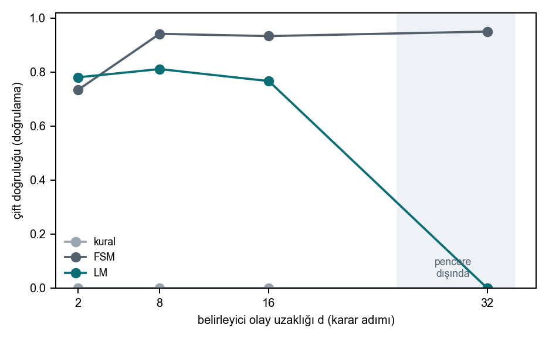

# Bitirme Projesi I — teknik rapor (WP1–WP4)

Murat Atçeken · Mehmet Akif Ayzit · danışman Prof. Dr. Cem Ünsalan · 21 Kasım 2026 · sözleşme sha256 `0b1ea82508605a72…`

Bu rapor `sw/decision/proje1_report.py` tarafından proje çıktılarından üretilir; elle sayı yazılmaz. Test bölümü ön kayıt gereği açılmamıştır; bütün karar kalitesi sayıları **doğrulama** bölümüne aittir.

## 1. İş paketlerinin durumu

| Görev | Çıktı | Durum | Kanıt |
|---|---|---|---|
| WP1.1 | D1.1 kanıt kaydı | tamam | `docs/decision/D1.1_kanit_kaydi.md` |
| WP1.2 | D1.2 hipotez matrisi | tamam | `D1.2_arastirma_sorusu_matrisi.md` |
| WP1.3 | D1.3 alt sistem ve arıza tanımı | tamam (üretilmiş) | `D1.3_…`, `M1/fig_directed.png` |
| WP1.4 | D1.4 eylem ve guard tabloları | tamam (üretilmiş) | `D1.4_…` |
| WP1.5 | D1.5 değerlendirme protokolü | tamam (ön kayıt) | `D1.5_degerlendirme_protokolu.md` |
| WP1.6 | M1 şartname paketi | paket hazır; danışman kaydı bekliyor | `docs/decision/M1/README.md` |
| WP2.1–2.3 | kapalı döngü simülatör, arızalar, eylem etkileri | tamam | `sim.py`, `tests/decision` |
| WP2.4 | eşlenik çift kataloğu | tamam | `pairs.py`, manifestler |
| WP2.5 | donmuş bölümler | tamam | `sw/decision/manifests/*.json` (sha256) |
| WP3.1–3.2 | kural ve FSM | tamam; RTL ile bit düzeyinde aynı | `policies.py`, `dec_policies.sv` |
| WP3.3 | tokenlaştırıcı ve politika arayüzü | tamam; RTL ile aynı | `tokenizer.py`, `dec_tokenizer` |
| WP3.4 | GRU, 3 tohum | tamam | `model/decision/gru_s*.{pt,json}` |
| WP3.5 | LM, 3 tohum | tamam | `model/decision/lm_s*.{pt,json}` |
| WP4.1–4.2 | dışa aktarma ve sayısal sözleşme | tamam | `D4_disa_aktarim_ve_sayisal_sozlesme.md` |
| WP4.3 | RTL arayüzü ve pilot yol | tamam | `decision_top.sv`, `scripts/dec_top.sh` |
| WP4.4 | bağımsız guard ve test takımı | tamam | `dec_guard.sv`, `scripts/dec_units.sh` |

## 2. Derlem

| Bölüm | Çift | Senaryo / bölüm | sha256 (dizi) |
|---|---|---|---|
| doğrulama | 480 | 960 | 76f7036c3119b1c3 |
| test (kapalı) | 2880 | 5760 | c73a4bb9968346b0 |
| eğitim | — | 20630 | d0a6be8b5125a667 |

Eğitim etiket dağılımı (NORMAL, YUKU_KAPAT, KISITLI_MOD, GUVENLI_MOD): [684447, 45613, 241421, 541589].


## 3. Doğrulama kümesinde dört yöntem

480 eşlenik çift (48 hücre × 10). Çift doğruluğu: iki üyede de kabul edilebilir eylem. Öğrenen modeller için 3 tohumun ortalaması ± standart sapma; parantezde tohum 0'ın çift düzeyinde %95 bootstrap güven aralığı. Test bölümü Proje I'de açılmadı.

| Yöntem | Senaryo doğruluğu | Çift doğruluğu | d=2 | d=8 | d=16 | d=32 |
|---|---|---|---|---|---|---|
| rule | 0.493 | 0.000 (0.000–0.000) | 0.000 | 0.000 | 0.000 | 0.000 |
| fsm | 0.940 | 0.890 (0.860–0.919) | 0.733 | 0.942 | 0.933 | 0.950 |
| lm | 0.792 | 0.590 ± 0.030 (0.554–0.646) | 0.781 | 0.811 | 0.767 | 0.000 |

### Şablon × d (çift doğruluğu)

| Yöntem | BAT_SEN/d2 | BAT_SEN/d8 | BAT_SEN/d16 | BAT_SEN/d32 | SEN/d2 | SEN/d8 | SEN/d16 | SEN/d32 | OC/d2 | OC/d8 | OC/d16 | OC/d32 |
|---|---|---|---|---|---|---|---|---|---|---|---|---|
| rule | 0.00 | 0.00 | 0.00 | 0.00 | 0.00 | 0.00 | 0.00 | 0.00 | 0.00 | 0.00 | 0.00 | 0.00 |
| fsm | 0.60 | 0.90 | 0.85 | 0.97 | 0.90 | 0.97 | 0.95 | 1.00 | 0.70 | 0.95 | 1.00 | 0.88 |
| lm | 0.87 | 0.96 | 0.93 | 0.00 | 0.95 | 0.95 | 0.88 | 0.00 | 0.53 | 0.53 | 0.50 | 0.00 |

### Pencere içinde (d ≤ 16) üye düzeyinde senaryo doğruluğu

BAT_SEN: A = sensör arızası → KISITLI_MOD, B = batarya kapasite kaybı → GUVENLI_MOD. SEN: A = sağlam → NORMAL, B = takılı sensör → KISITLI_MOD. OC: A = tek geçici aşırı akım → NORMAL, B = aralıklı aşırı akım → KISITLI_MOD.

| Yöntem | BAT_SEN/A | BAT_SEN/B | SEN/A | SEN/B | OC/A | OC/B |
|---|---|---|---|---|---|---|
| rule | 0.94 | 0.00 | 0.99 | 0.01 | 1.00 | 0.00 |
| fsm | 0.91 | 0.83 | 0.97 | 0.97 | 0.99 | 0.89 |
| lm | 0.94 | 0.97 | 0.99 | 0.94 | 0.55 | 0.96 |

### INT8 karar uyuşması (doğrulama kümesi, float ↔ tamsayı)

Marj: float üst-2 logit farkı. Uyuşmazlıklar ve hangi tarafın kabul edilebilir eylemi seçtiği `mem/decision/<model>/export.json` içinde (`disagreements`).

| Model | n | Uyuşma | Uyuşmazlık | Marj ≥ 0,2 iken uyuşma | Float doğruluk | INT8 doğruluk |
|---|---|---|---|---|---|---|
| lm_s0 | 960 | 0.9875 | 12 | 1.000 (n = 897) | 0.795 | 0.797 |
| lm_s1 | 960 | 0.9896 | 10 | 1.000 (n = 886) | 0.777 | 0.777 |
| lm_s2 | 960 | 0.9948 | 5 | 1.000 (n = 906) | 0.804 | 0.809 |





### Bulgular

- **Negatif kontrol tuttu.** d = 32'de belirleyici olay LM'in 127 tokenlık bağlamının dışında; tohum başına çift doğruluğu 0,00, 0,00, 0,00. Çiftin iki üyesi LM'e aynı göründüğü için aynı kararı alıyor; kabul kümeleri ayrık olduğundan en çok bir üye doğru olabiliyor.
- **Pencere içinde (d ≤ 16)** ortalama çift doğruluğu LM 0,79, FSM 0,87. d = 2'de LM 0,78, FSM 0,73.
- **OC şablonunda LM temkinli tarafta hata yapıyor.** Pencere içinde aralıklı aşırı akımı (B) 0,96 oranında doğru biçimde KISITLI_MOD'a alıyor; tek geçici olaydan sonra (A) NORMAL'e dönme oranı yalnız 0,55. Hatalar gereksiz kısıtlı mod yönünde, kaçırılan arıza yönünde değil. OC çift doğruluğu d = 2'de de düşük (0,53), yani sorun bellek değil öğrenilen karar sınırı (Proje II: OC örneklerinin derlemdeki payı, etiket duyarlılığı).
- **FSM olumlu kontrolü d ≥ 8'de büyük ölçüde tutuyor** (0,93–0,95); d = 2'de 0,73. Yük anahtarlamasından sonraki 3 adımlık doğrulama penceresi d = 2'de karar anında henüz kapanmamış olabiliyor; plandaki “FSM ≈ %100” beklentisi bu yüzden tutmadı.
- **Eşik kuralı** geçmişe bakmadığı için çiftin iki üyesinde aynı kararı veriyor: çift doğruluğu 0,00, senaryo doğruluğu 0,49.
- **INT8:** float ile karar uyuşması 0,9875–0,9948. Bütün uyuşmazlıklar float üst-2 marjı 0,2'nin altında olan neredeyse-eşitliklerde; INT8 doğruluğu float'tan düşük değil.
- **Karar süresi (lm_s0):** RTL'de 27406–31278 çevrim, 25 MHz'de 1,10–1,25 ms (hedef ≤ 10 ms). Bu bir WCET kanıtı değil, ölçülen en uzun değerdir.


## 4. Aşama kapıları (planın S6–S7 ölçütleri)

| Kapı | Model | Ölçülen | Sonuç | Not |
|---|---|---|---|---|
| S6 INT8 uyuşması ≥ 0,99 | lm_s0 | 0,9875 (n = 960) | geçmedi | 12 uyuşmazlığın hepsi float üst-2 marjı < 0,2 olan neredeyse-eşitliklerde; marj ≥ 0,2 iken uyuşma 1,000 |
| S6 INT8 uyuşması ≥ 0,99 | lm_s1 | 0,9896 (n = 960) | geçmedi | 10 uyuşmazlığın hepsi float üst-2 marjı < 0,2 olan neredeyse-eşitliklerde; marj ≥ 0,2 iken uyuşma 1,000 |
| S6 INT8 uyuşması ≥ 0,99 | lm_s2 | 0,9948 (n = 960) | geçti |  |
| S7 iz = hw_ref | lm_s0 | 1152 adım, 0 hata | geçti |  |
| S7 iz = hw_ref | rule | 1152 adım, 0 hata | geçti |  |
| S7 iz = hw_ref | fsm | 1152 adım, 0 hata | geçti |  |
| D1.2 en uzun karar ≤ 10 ms (25 MHz) | lm_s0 | 31278 çevrim = 1,25 ms | geçti |  |
| S7 kapı düzeyi netlist (kart öz-testi) | lm_s0_fsm | 24/24 senaryo eşleşti | geçti |  |
| S7 25 MHz zamanlama | lm_s0_fsm | Fmax 87,8 MHz | geçti |  |
| S7 25 MHz zamanlama | lm_s0_lm | Fmax 26,5 MHz | geçti |  |

## 5. Eğitim kayıtları

| Çalıştırma | Parametre | lr | Adım | Batch | Cihaz | Val senaryo | Val çift | Süre (dk) |
|---|---|---|---|---|---|---|---|---|
| lm_s0 | 40608 | 0.001 | 6000 | 64 | mps | 0.795 | 0.598 | 34 |
| lm_s1 | 40608 | 0.001 | 6000 | 64 | mps | 0.777 | 0.556 | 48 |
| lm_s2 | 40608 | 0.001 | 6000 | 64 | mps | 0.804 | 0.615 | 51 |

## 6. RTL doğrulama sonuçları

Birim testleri (`make dec-units`): guard 73.728 vektör, tokenlaştırıcı 334, kural 3.705, FSM 64.080 adım, bekçi zamanlayıcı 400 durum — Verilator ve Icarus ile 0 hata.

```
[lm_s0] RESULT lm_s0 steps 1920 bad_steps 0 errors 0 avg_cycles 7682 min_cycles 6809 max_cycles 7817
[lm_s0] RESULT decision_top policy 0 scenarios 24 steps 1152 errors 0 dec_cycles min 27406 max 31278
[lm_s0] RESULT board policy 0: scenarios 24 matched 24 green 1 red 0 cycles 47089348
[rule] RESULT decision_top policy 1 scenarios 24 steps 1152 errors 0 dec_cycles min 2 max 2
[fsm] RESULT decision_top policy 2 scenarios 24 steps 1152 errors 0 dec_cycles min 2 max 2
[lm_s0_fsm netlist] RESULT board policy 2: scenarios 24 matched 24 green 1 red 0 cycles 3006972
```


## 7. Donanım maliyeti (Yosys sentezi, nextpnr yerleşimi; xc7a100t)

| Yapılandırma | LUT | FF | BRAM | DSP |
|---|---|---|---|---|
| fsm | 404 | 302 | 1.5 | 3 |
| guard | 61 | 44 | 0.0 | 0 |
| lm_s0 | 6523 | 2337 | 18.0 | 60 |
| rule | 205 | 243 | 1.5 | 3 |

| Kart öz-testi | Saat (MHz) | Zamanlama | Fmax (MHz) | LUT (yerleşim) |
|---|---|---|---|---|
| lm_s0_fsm | 25 | tutuyor | 87.76 | 1374/126800 |
| lm_s0_lm | 25 | tutuyor | 26.52 | 28340/126800 |

| Kapı düzeyi netlist simülasyonu | Senaryo | Eşleşen | Çevrim | Sonuç |
|---|---|---|---|---|
| lm_s0_fsm | 24 | 24 | 3006972 | yeşil |

Netlist simülasyonu, nextpnr'a verilen Yosys netlistini (MMCM, BUFG, G/Ç tamponları, BRAM içerikleri dahil) Yosys hücre modelleriyle yalnız pinlerden sürer (`scripts/dec_netlist_sim.sh`).


Kart öz-testleri `-nodsp` ile yerleştirilmiştir (Yosys 0.69'un DSP48E1 işaret genişletme hatası); FSM ve kural tepelerindeki LUT'ların çoğu iz hash'inin 32 bit çarpıcısıdır. Fmax açık kaynak aracın tahminidir; üretici aracı ya da kart ölçümü değildir.


## 8. Proje II'ye devredenler

- M1 gözden geçirme kaydı ve açık maddelerin kapatılması (`docs/decision/M1/README.md`).
- Test bölümünün bir kez açılması, H1–H3 istatistikleri (D1.5).
- WP3.6 ablasyonları (geçmiş karıştırma, 1 katman × 128 bant), etiket duyarlılığı (H, τ, saf kural).
- RTL halka tamponlu KV (uzun akış), yumuşak RISC-V çekirdek karşılaştırması (H3), kart üzerinde kapalı döngü (tesis modeli RTL'de).
- FSM'nin d = 2'deki zayıflığı (3 adımlık doğrulama penceresi) ve düşük kabul oranlı hücreler (M1 madde 4).
